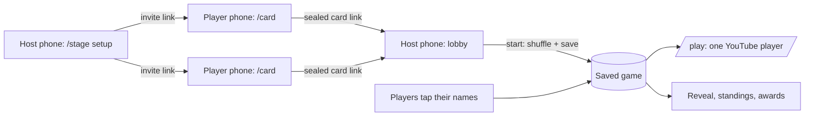

# Architecture

## Shape

KaarGaan is a static React 19 + TypeScript + Vite PWA that runs entirely in the browser. It uses React Router for its four screens (home loads first; the others are lazy chunks, preloaded when the phone is idle and precached for offline use), plain CSS (`src/styles/buzzer.css`), `vite-plugin-pwa` for the app shell, `qrcode` / `qr-scanner` for QR codes, and the official YouTube iframe API for playback. It has no server code, accounts or remote state.

Links travel over whatever the group already uses (share sheet, chat, QR). Nothing connects the phones to each other.

## Layers

- **Engine** (`src/lib/gameEngine.ts`, `awards.ts`, `revealMoment.ts`): pure functions with no React, DOM, storage or playback. Shuffle randomness is injected for tests. Each action checks the round phase and throws on an invalid move, so a repeated reveal can't score twice.
- **Cards** (`card.ts`, `cardDraft.ts`): invite and card formats, sealing with Web Crypto AES-GCM, and the player's saved draft. See [ADR 0006](adr/0006-sealed-song-cards.md).
- **Lobby** (`lobby.ts`, `stageStore.ts`, `slots.ts`): a reducer for collecting cards, with clash and duplicate rules. Persistence covers the lobby, setup and crew.
  - `latestLobby()` re-reads the saved lobby before every change. A `storage` listener keeps other tabs in step, so card links opened in several tabs all land in the same lobby.
- **Persistence** (`gamePersistence.ts`): one current game, versioned and base64-encoded, with a save revision to catch stale tabs. Old phases are migrated on load.
- **Playback** (`youtubePlayer.ts`, `pages/play/PlayerDock.tsx`):
  - The iframe API loads once, and each game creates one player; each round cues its video.
  - Player events only report problems. They never award points, reveal owners or advance a round. The one exception is an unplayable song, which skips its own round while voting is open.
  - A wake lock keeps the screen on while a game is playing.
- **Feel** (`sfx.ts`, `motionFeatures.ts`, `ui/StageBackdrop.tsx`): synthesised sounds and buzzes behind one switch, the lazily loaded `motion` engine, and the decorative stage. None of it reads game state that isn't already on screen.
- **Screens** (`src/pages/{card,stage,play}`, `HomePage.tsx`) and shared UI (`src/ui`). They only ever render what the current phase needs. Owner ids, player ids and the future queue never reach the DOM before a reveal.

## Privacy boundary

Ownership is hidden from every screen, from accessible text and from URLs until the reveal. Songs are sealed from the moment a player taps Seal. The host phone necessarily holds the key and the full game in `localStorage`, so someone deliberately poking at storage can learn the answers. The group accepts this ([ADR 0001](adr/0001-single-device-static-pwa.md)).

## YouTube and phones

- Playback uses a visible official player with `playsinline`. Nothing hides the video, strips ads, proxies or caches media.
- Phones can ignore a scripted `playVideo()`. When the player isn't playing 1.5s after a tap, the screen asks the host to tap the video itself.
- Errors 100, 101 and 150 (removed, private, embedding off) skip the round automatically. Other errors offer "Try again" or "Skip". See [ADR 0007](adr/0007-open-voting-embed-only-playback.md).

## PWA and hosting

- The service worker caches first-party assets only, so the shell opens offline; songs still need internet.
- An available update is offered with a banner, but never while a game is playing, because updating reloads the page.
- Cloudflare Pages serves `dist/` with an SPA fallback (`public/_redirects`), without Functions or Workers. Domain: `kaargaan.sohab.dev`.

- [YouTube iframe API](https://developers.google.com/youtube/iframe_api_reference)
- [YouTube developer policies](https://developers.google.com/youtube/terms/developer-policies-guide)
- [Vite PWA](https://vite-pwa-org.netlify.app/guide/)
- [Web Crypto AES-GCM](https://developer.mozilla.org/en-US/docs/Web/API/SubtleCrypto/encrypt#aes-gcm)
